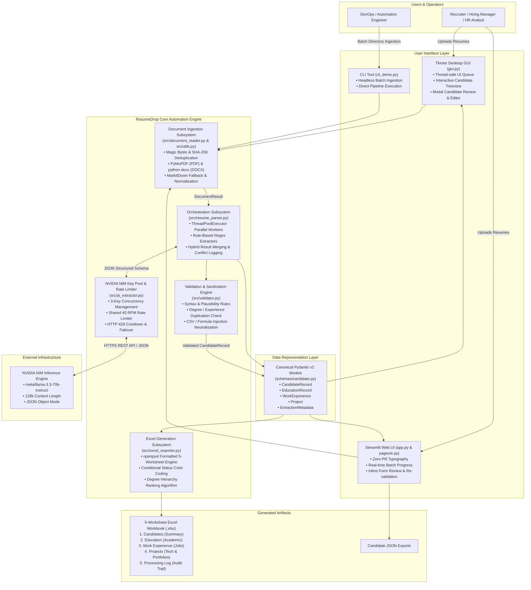
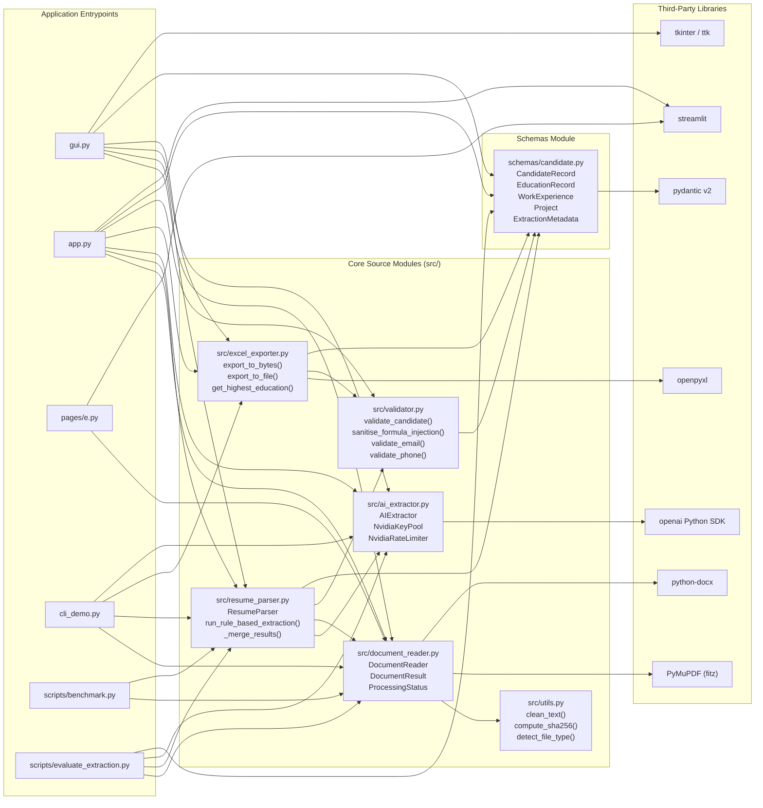
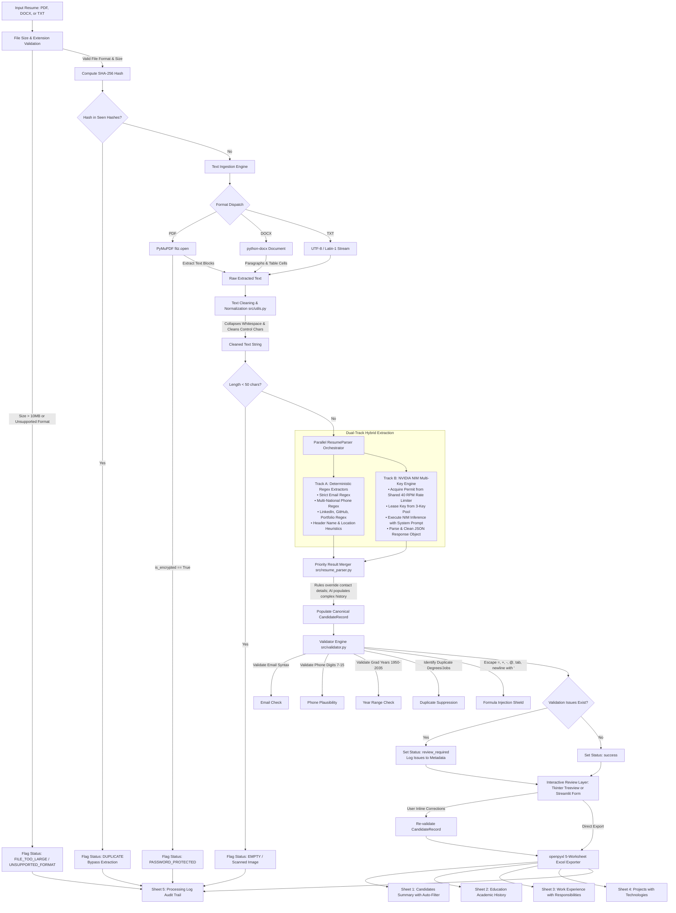
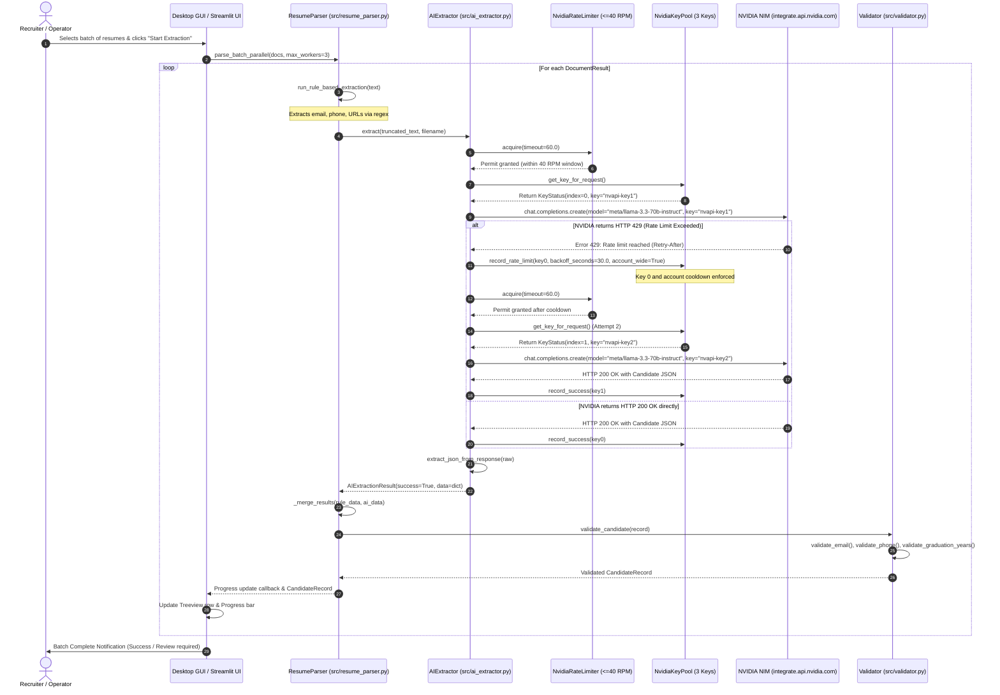
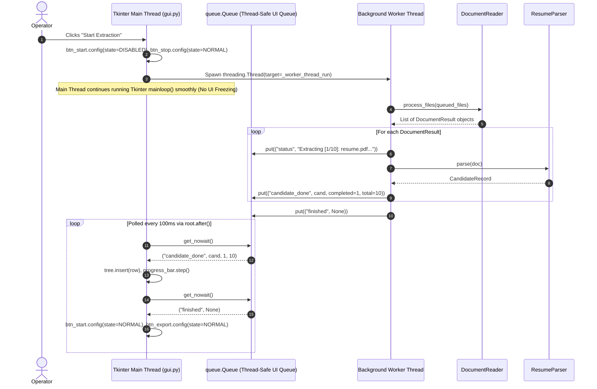
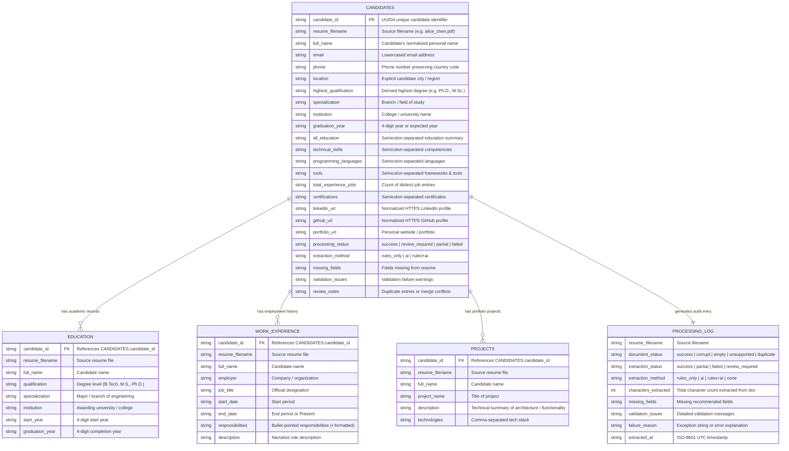
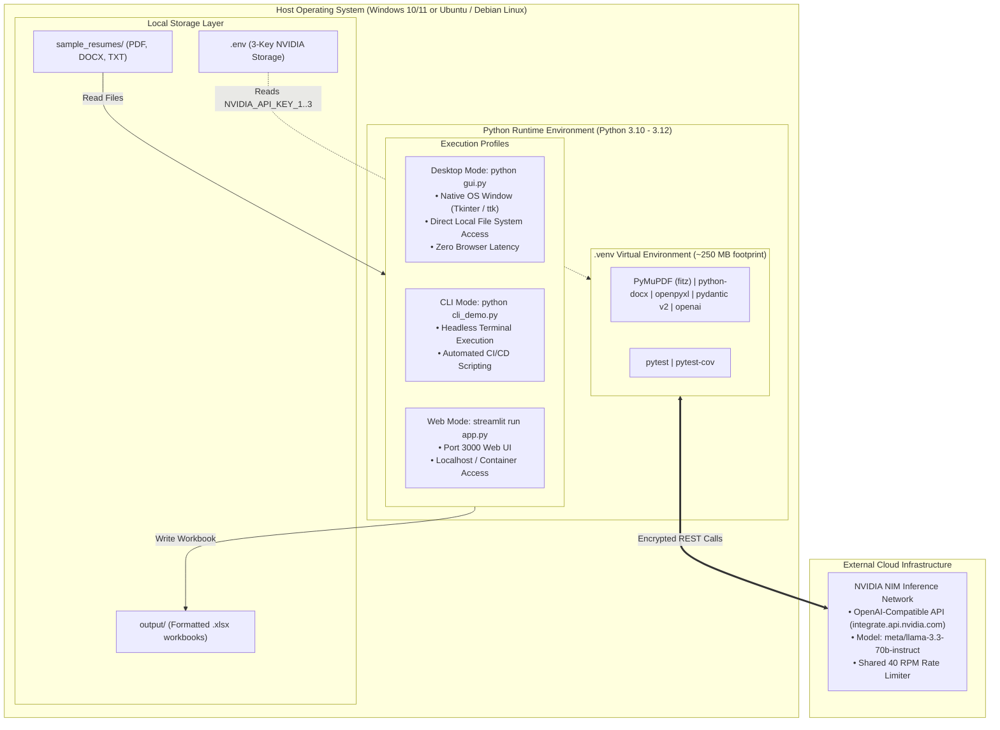

# System Architecture & Technical Diagrams Dossier
## Project: ResumeDrop (AI Resume Extraction & Excel Automation)

This document contains verified, implementation-grounded Mermaid architecture and technical diagrams for **ResumeDrop**. Every connection, module boundary, data structure, and interaction depicted in these diagrams is directly backed by source code evidence in the repository.

---

## 1. System Context & High-Level Architecture (C4 Level 1/2)

### Source Evidence:
- UI entry points: `gui.py` (Desktop GUI), `app.py` (Streamlit Web), `cli_demo.py` (Command Line Interface).
- Processing pipeline: `src/document_reader.py`, `src/resume_parser.py`, `src/ai_extractor.py`, `src/validator.py`, `src/excel_exporter.py`.
- External service: NVIDIA NIM API (`https://integrate.api.nvidia.com/v1`).
- Storage & Output: Local filesystem (`.xlsx` workbooks, `.json` dumps).

---

## 2. Component & Subsystem Dependency Diagram

### Source Evidence:
- `gui.py` imports `src.document_reader`, `src.resume_parser`, `src.ai_extractor`, `src.excel_exporter`, `schemas.candidate`.
- `app.py` imports identical core modules plus `src.validator`.
- `src/resume_parser.py` imports `src.ai_extractor.AIExtractor`, `src.document_reader.DocumentResult`, `src.validator.validate_candidate`, `schemas.candidate.*`.
- `src/document_reader.py` imports `src.utils.*`, `fitz` (PyMuPDF), `docx`, optional `markitdown`.
- `src/excel_exporter.py` imports `openpyxl`, `schemas.candidate.*`, `src.validator.sanitise_formula_injection`.

---

## 3. End-to-End Data Flow Diagram

### Source Evidence:
Traces the lifecycle of a resume file from ingestion to final spreadsheet rows:
1. `DocumentReader.process_bytes` or `process_files` (`src/document_reader.py:85-124`).
2. Deduplication check via `compute_sha256` (`src/utils.py:26-36`).
3. Extraction via `PyMuPDF`/`python-docx` (`src/document_reader.py:240-311`).
4. Parsing via `ResumeParser.parse` (`src/resume_parser.py:377-440`).
5. Dual-track extraction (regex in `src/resume_parser.py:92-202` + LLM prompt in `src/ai_extractor.py:353-457`).
6. Priority merge in `_merge_results` (`src/resume_parser.py:336-360`).
7. Quality validation and formula escaping in `src/validator.py:72-148`.
8. 5-worksheet dispatch in `src/excel_exporter.py:330-347`.

---

## 4. Sequence Diagram: 3-Key NVIDIA NIM Extraction, Rate Limiting & Failover

### Source Evidence:
- `src/ai_extractor.py`: `NvidiaKeyPool.get_key_for_request()`, `NvidiaRateLimiter.acquire()`, `record_rate_limit()`, `record_success()`.
- `src/ai_extractor.py`: `AIExtractor.extract()`.
- `src/resume_parser.py`: `ResumeParser.parse()`.

---

## 5. Sequence Diagram: Desktop GUI Threading Architecture

### Source Evidence:
- `gui.py:47-73`: Tkinter initialization, `ui_queue`, and `root.after(100, self._process_ui_queue)`.
- `gui.py:378-411`: Background thread spawn `threading.Thread(target=self._worker_thread_run, daemon=True)`.
- `gui.py:463-551`: Thread-safe UI polling via `Queue.get_nowait()`.

---

## 6. Entity-Relationship & Relational Data Model (Workbook Structure)

### Source Evidence:
- Schemas: `schemas/candidate.py:25-146`.
- Spreadsheet generator: `src/excel_exporter.py:112-328`.
- Foreign key relationship: `CandidateRecord.candidate_id` (UUID4 string) acts as the primary key in `Candidates` and the foreign key in `Education`, `Work Experience`, and `Projects`.

---

## 7. Deployment & Operational Environment Architecture

### Source Evidence:
- Deployment manual: `SETUP.md` (Windows PowerShell & Linux Bash).
- Development container: `.devcontainer/devcontainer.json`.
- Startup script: `run_dev.sh` (Streamlit web server on port 3000).
- Configuration: `package.json`, `.env.example`, `pytest.ini`.

