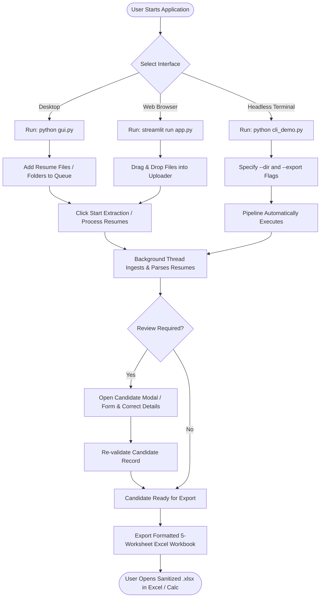

# Project Overview & System Identity
## Project: ResumeDrop (AI Resume Extraction & Excel Automation)

---

## 1. Project Identification & High-Level Summary

**ResumeDrop** is a 100% Python-native, desktop- and web-automated resume extraction and applicant management system. It ingests batches of unstructured resumes in PDF, DOCX, and TXT formats, extracts structured candidate records using a high-throughput, 3-key NVIDIA NIM pool (`meta/llama-3.3-70b-instruct`) with automatic HTTP 429 rate-limit failover, shared 40 RPM rate limiting, and rule-based regex fallback, validates the extracted data against canonical Pydantic v2 schemas, neutralizes formula injection vulnerabilities, and exports a professionally styled 5-worksheet Excel workbook.

### Key Identity Facts:
- **Project Name**: ResumeDrop
- **Repository URL**: `https://github.com/anuragrathod/ResumeDrop`
- **Technical Domain**: Natural Language Processing (NLP), Information Extraction (IE), Document Object Modeling (DOM), Desktop & Web Automation
- **Runtime & Language**: 100% Pure Python (Python 3.10, 3.11, 3.12); zero Node.js/TypeScript dependencies
- **Operating Platforms**: Windows 10/11, Debian/Ubuntu Linux, macOS
- **Primary Interfaces**: 
  1. Native Desktop GUI (`gui.py`) built with standard Python `tkinter` and `ttk`.
  2. Responsive Web UI (`app.py` & `pages/e.py`) built with Streamlit.
  3. Headless Command Line Interface (`cli_demo.py`) for automated batch processing.

---

## 2. Background and Problem Statement

### 2.1 The Real-World Problem
In modern talent acquisition and recruitment operations, organizations receive hundreds to thousands of resumes for every open position. These documents are submitted in diverse, unstructured formats with inconsistent styling, varying fonts, multi-column tables, graphics, and customized section headers.

### 2.2 Shortcomings of Current Approaches
1. **Manual Data Entry**: Recruiters manually read each resume, copy candidate details, and re-type them into internal tracking spreadsheets or ATS software. This process consumes 3 to 6 minutes per resume, introduces transcription errors, and creates severe hiring bottlenecks.
2. **Brittle Regex-Only Parsers**: Traditional keyword and regex parsers easily break when encountering non-standard headings, split telephone numbers, or non-linear multi-column layouts. They cannot reliably synthesize work experience, summarize bullet points, or parse complex academic qualifications.
3. **Heavy Deep-Learning OCR Bloat**: Modern neural OCR and document understanding frameworks (such as LayoutLM, Docling, or PyTorch-based vision models) require 4 GB to 10 GB of dependencies, dedicated CUDA GPUs, and long cold-start times. These heavy dependencies make local installation on standard recruiter laptops impractical.
4. **Single-Key API Quota Exhaustion**: Cloud-based LLM solutions that rely on a single API key quickly encounter HTTP 429 (Too Many Requests) rate limits when processing resume batches, aborting entire recruitment pipelines mid-run.
5. **Spreadsheet Formula Injection (CWE-1236)**: Unsanitized candidate text containing characters such as `=`, `+`, `-`, or `@` exported into spreadsheets can execute arbitrary commands or exfiltrate data when opened in Microsoft Excel.

### 2.3 Justification for ResumeDrop
ResumeDrop addresses these challenges through a lightweight, pure-Python hybrid architecture:
- Fast document text parsing via `PyMuPDF` (`fitz`) and `python-docx` (~250 MB total environment footprint vs. >4 GB).
- Three-key NVIDIA NIM pool (`NvidiaKeyPool`) providing round-robin leasing and shared concurrency-safe 40 RPM rate limiting for uninterrupted batch processing.
- Dual-track extraction combining deterministic regex rules for contact info with generative NIM models for complex career and project histories.
- Enterprise-grade validation and formula injection sanitization.

---

## 3. Main Aim and Specific Objectives

### Aim
To develop a high-throughput, cross-platform resume ingestion and candidate data extraction system that transforms unstructured PDF, DOCX, and TXT resumes into audit-ready, 5-worksheet Excel workbooks with zero deep-learning installation bloat.

### Numbered Objectives:
1. **OBJ-01 (Pure Python Architecture)**: Build a 100% Python solution free of Node.js, TypeScript, or npm dependencies, with verified cross-platform compatibility on Windows and Linux.
2. **OBJ-02 (High-Speed Ingestion)**: Implement digital text extraction for PDF, DOCX, and TXT achieving >500 resumes/sec throughput with SHA-256 batch deduplication.
3. **OBJ-03 (Resilient Multi-Key Inference)**: Engineer a thread-safe 3-key API pool supporting NVIDIA keys with shared 40 RPM rate limiting and automatic HTTP 429 failover.
4. **OBJ-04 (Responsive Desktop GUI)**: Develop a native desktop application in `tkinter`/`ttk` featuring non-blocking background worker threads, live progress bars, candidate Treeview, and inline editing.
5. **OBJ-05 (Offline Fallback Engine)**: Deliver deterministic regex extractors capable of extracting email, phone, and social links completely offline without cloud API keys.
6. **OBJ-06 (Data Integrity & Formula Shielding)**: Enforce Pydantic v2 schema validation (graduation years 1950–2035) and neutralize formula injection attacks (`=`, `+`, `-`, `@`, `\t`, `\r` escaped with `'`).
7. **OBJ-07 (Structured Spreadsheet Output)**: Generate a 5-worksheet Excel workbook (`Candidates`, `Education`, `Work Experience`, `Projects`, `Processing Log`) with auto-filters, frozen panes, and conditional status formatting.

---

## 4. Scope and Boundaries

### In-Scope:
- Ingestion of PDF (digital text), DOCX, and TXT resume files up to 10 MB.
- Detection of encrypted/password-protected PDFs and zero-byte files.
- SHA-256 content deduplication within a batch.
- Extraction of candidate identity, email, phone, location, social links, education, work experience, projects, skills, and certifications.
- Interactive candidate review and inline editing prior to export.
- Export to formatted 5-worksheet `.xlsx` workbooks and JSON records.

### Out-of-Scope (Boundaries):
- Scanned PDF optical character recognition (OCR) via external vision models (scanned images are detected and safely flagged as `EMPTY` to maintain a lightweight environment).
- Persistent relational database storage (ResumeDrop operates as a stateless, file-based pipeline).
- Multi-tenant user authentication or cloud account management.
- Direct proprietary ATS integrations.

---

## 5. Users, Roles, and How the System Is Used

### 5.1 User Roles and Responsibilities

| User Role | Primary Objective | Key Actions Available | Input Provided | Output Received |
|---|---|---|---|---|
| **Recruiter / Talent Acquisition Specialist** | Batch-screen candidate resumes for open positions. | Add resumes or entire folders; trigger extraction; inspect candidate Treeview; review validation warnings; edit candidate fields; export to Excel. | PDF, DOCX, or TXT resume files | Formatted 5-worksheet `.xlsx` workbook; summarized candidate table |
| **Technical Hiring Manager** | Evaluate candidate technical skills and project histories. | Review parsed candidate profiles; inspect top skills and project technologies; review raw text snippets for contextual verification. | Candidate records in review modal | Normalized candidate skill sets; project summaries; employment timelines |
| **HR Operations / Placement Officer** | Maintain structured candidate databases and audit logs. | Run batch processing; inspect `Processing Log` sheet for failed documents, missing fields, and extraction methods; export JSON data. | Resume batches | Audit trail; error logs; standardized candidate spreadsheets |
| **DevOps / Automation Engineer** | Integrate resume parsing into headless pipelines or CI/CD scripts. | Execute CLI batch extraction (`cli_demo.py`); specify input directories and output paths; automate spreadsheet generation. | Command-line arguments; directory paths | Terminal execution logs; generated `.xlsx` workbooks |

### 5.2 User Journeys

#### Desktop GUI User Journey (`gui.py`):
1. **Launch**: User launches `python gui.py`. The window displays the API key pool health status.
2. **Queueing**: User clicks **+ Add Files** or **+ Add Folder** to queue resumes. File count updates in real time.
3. **Execution**: User clicks **▶ Start Extraction**. A background worker thread parses documents and executes AI/rule extraction. The progress bar updates smoothly without freezing the UI.
4. **Review**: Candidate records appear in the Treeview with color-coded status badges. The user double-clicks any record to open the Candidate Review modal, inspects validation notes or text snippets, and saves inline corrections.
5. **Export**: User clicks **📥 Export to Excel (.xlsx)**, selects a destination file, and receives the 5-worksheet workbook.

#### Web Interface User Journey (`app.py`):
1. **Access**: User navigates to `http://localhost:3000`.
2. **Upload**: User drags resume files into the file uploader. Duplicate filenames and file sizes are displayed.
3. **Process**: User clicks **Process resumes**. Live progress logs show per-document extraction status.
4. **Inspect & Edit**: Summary metrics (Verified, Needs Review, Failed) are shown. Expandable candidate cards allow inline form editing with immediate re-validation.
5. **Download**: User clicks **⬇ Download Excel workbook** or **⬇ Download JSON**.

### 5.3 User Interaction Workflow Diagram

