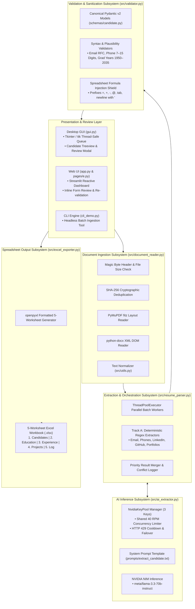
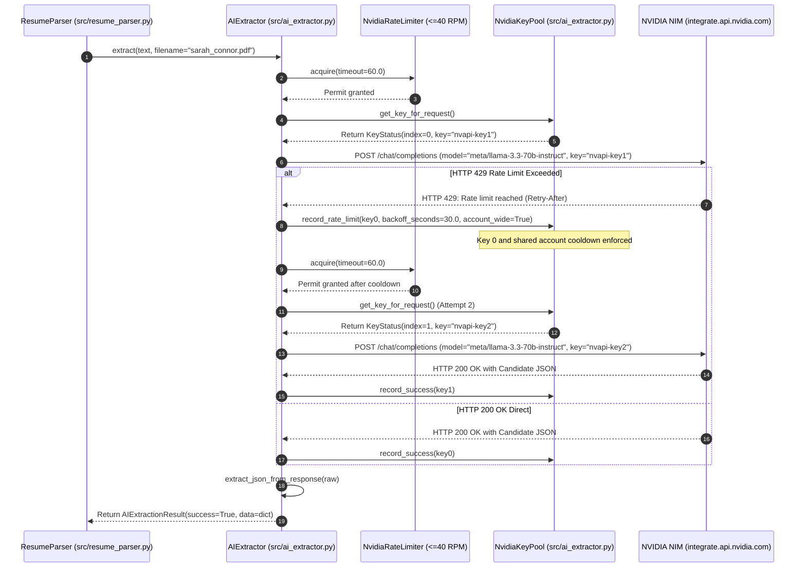

# Working Flow and System Architecture
## Project: ResumeDrop (AI Resume Extraction & Excel Automation)

This document provides a detailed explanation of the overall system architecture, component relationships, data movements, and the complete step-by-step working flow of **ResumeDrop**.

---

## 1. System Architecture Overview

ResumeDrop is architected around a **Modular Pipeline Pattern** coupled with a **Dual-Track Hybrid Extraction Strategy** and an **Asynchronous Desktop/Web Presentation Layer**.



---

## 2. Complete Step-by-Step Working Flow

The real-world operation of ResumeDrop is structured into 9 sequential stages:

### Stage 1: File Selection & Queueing
- **Trigger**: The recruiter opens the desktop GUI (`python gui.py`) or Web UI (`app.py`) and selects files or folders.
- **Input**: A collection of files (`.pdf`, `.docx`, `.txt`).
- **Processing**: The GUI verifies that files exist on the filesystem and adds them to `queued_files`. The visual queue listbox displays icons and file names.
- **Error Handling**: If a folder contains unsupported files (e.g. `.png` or `.exe`), they are filtered out during file discovery.

### Stage 2: Ingestion & Validation
- **Component**: `src/document_reader.py:DocumentReader._process_single()`
- **Checks**:
  1. *Extension & Magic Bytes*: Validates extension against `{".pdf", ".docx", ".txt"}` and verifies file header magic bytes (`%PDF` for PDF, `PK\x03\x04` for DOCX). Unsupported formats return `ProcessingStatus.UNSUPPORTED_FORMAT`.
  2. *Zero-Byte Check*: If `file_size == 0`, returns `ProcessingStatus.EMPTY_FILE`.
  3. *Size Limit*: If `file_size > 10 MB`, returns `ProcessingStatus.FILE_TOO_LARGE`.
  4. *Cryptographic Deduplication*: Computes SHA-256 hash via `src/utils.py:compute_sha256()`. If the hash was previously processed in the current batch, it is flagged as `ProcessingStatus.DUPLICATE`, skipping redundant extraction.

### Stage 3: Python-Native Text Extraction
- **Component**: `src/document_reader.py`
- **Processing**:
  - *PDF Documents*: Parsed by `fitz.open()` (PyMuPDF). Checks `doc.is_encrypted`. If encrypted, returns `ProcessingStatus.PASSWORD_PROTECTED`. Otherwise, extracts layout-aware text across all pages.
  - *Word Documents*: Parsed by `docx.Document()`. Extracts body paragraphs and iterates through table cells, joining cells with ` | ` delimiters.
  - *Plain Text*: Decoded using UTF-8 with fallback to Latin-1 error replacement.

### Stage 4: Text Cleaning & Normalization
- **Component**: `src/utils.py:clean_text()`
- **Processing**:
  - Replaces Windows CRLF (`\r\n`) and Mac (`\r`) linebreaks with standard newline `\n`.
  - Strips non-printable ASCII control characters (`\x00`–`\x08`, `\x0B`–`\x0C`, `\x0E`–`\x1F`).
  - Normalizes non-breaking spaces (`\u00A0`, `\u2000`–`\u200B`) to standard spaces.
  - Collapses consecutive whitespace and runs of 3+ newlines into 2 newlines.
  - Checks if text contains fewer than 50 non-whitespace characters (`is_text_empty()`). If so, flags file as `ProcessingStatus.EMPTY` (scanned bitmap PDF).

### Stage 5: Dual-Track Hybrid Extraction
- **Component**: `src/resume_parser.py:ResumeParser.parse()`
- **Parallel Dispatch**:
  - **Track A (Deterministic Regex)**: Runs compiled regexes for email, international phone numbers (+1, +44, +91, Indian 10-digit), LinkedIn URL, GitHub URL, and portfolio website.
  - **Track B (NVIDIA NIM Inference)**:
    1. Truncates text to 32,000 characters to respect model context windows.
    2. Acquires permit from `NvidiaRateLimiter` (aggregate limit <= 40 RPM).
    3. Leases an active key from `NvidiaKeyPool` (3 configured keys).
    4. Issues an HTTPS request to NVIDIA NIM API (`https://integrate.api.nvidia.com/v1`) with `response_format={"type": "json_object"}` and temperature `0.1`.
    5. Strips any `<think>` blocks or markdown fences and extracts balanced JSON.

### Stage 6: Priority Result Merging & Conflict Logging
- **Component**: `src/resume_parser.py:_merge_results()`
- **Resolution Logic**:
  - Deterministic regex extractions take strict priority for contact identifiers (`email`, `phone`, `linkedin_url`, `github_url`, `portfolio_url`) because regex patterns for standardized RFC emails and profile URLs are more reliable than LLM token predictions.
  - AI results populate rich, non-standard collections: `work_experience`, `education`, `projects`, `technical_skills`, `tools`, and `certifications`.
  - Any discrepancies between rule values and AI values are recorded in `metadata.review_notes` for recruiter audit.

### Stage 7: Validation, Plausibility & Formula Shielding
- **Component**: `src/validator.py:validate_candidate()`
- **Integrity Checks**:
  1. *Email Syntax*: Validates RFC format (`^[a-zA-Z0-9._%+-]+@[a-zA-Z0-9.-]+\.[a-zA-Z]{2,}$`).
  2. *Phone Plausibility*: Verifies digit count is between 7 and 15 digits.
  3. *Graduation Year Window*: Verifies graduation and start years fall within 1950 to 2035.
  4. *Duplicate Suppression*: Detects duplicate degrees (`institution_qualification`) and duplicate jobs (`employer_title`).
  5. *Formula Injection Sanitization*: Any text string starting with `=`, `+`, `-`, `@`, `\t`, or `\r` is escaped with a leading single quote `'` (`sanitise_formula_injection()`).
  6. *Status Assignment*: If any issues are found, status is set to `review_required`; otherwise, `success`.

### Stage 8: Interactive Review & Inline Editing
- **Desktop GUI**: Treeview lists candidates with colored status indicators (Green: Verified, Amber: Needs Review, Red: Failed). Double-clicking a candidate opens the modal editor showing validation warnings, editable text inputs, and raw resume text snippets. Saving re-runs `validate_candidate()` in real time.
- **Web UI**: Expandable cards provide inline forms to edit name, email, phone, location, skills, education, and experience with automatic re-validation.

### Stage 9: Formatted 5-Worksheet Excel Generation
- **Component**: `src/excel_exporter.py:export_to_file()` or `export_to_bytes()`
- **Workbook Architecture**:
  1. `Candidates`: One summary row per candidate; frozen header at row 1; auto-filter enabled; conditional background color on status cell (`#C6EFCE` green, `#FFEB9C` amber, `#FFC7CE` red). Highest academic degree ranked using academic hierarchy (Ph.D. > Master's > Bachelor's > Diploma > High School).
  2. `Education`: Normalized academic credentials (qualification, specialization, institution, start/grad year).
  3. `Work Experience`: Career history with employers, titles, dates, bullet-pointed responsibilities (`• ` formatted), and descriptions.
  4. `Projects`: Name, description, comma-separated technologies.
  5. `Processing Log`: Complete audit trail detailing resume filename, document status, extraction status, extraction method, character counts, missing fields, validation issues, failure reason, and ISO-8601 UTC timestamp.

---

## 3. 3-Key NVIDIA NIM Round-Robin, Rate Limiting, and HTTP 429 Failover



---

## 4. End-to-End Walkthrough Example

### Input Document: `alice_chen_resume.pdf`
```
Alice Chen
alice.chen@example.com | +1 (415) 555-0142 | San Francisco, CA
https://linkedin.com/in/alicechen | https://github.com/alicechen

SUMMARY
Senior Data Engineer with 7 years experience in distributed pipelines and ETL.

EDUCATION
M.Sc. Data Science — UC Berkeley, 2017
B.Sc. Computer Engineering — San Jose State University, 2015

SKILLS & TOOLS
Python, SQL, Apache Spark, Kafka, AWS, Docker, Kubernetes, PostgreSQL

EXPERIENCE
Lead Data Engineer — DataStream Inc. (Jan 2021 – Present)
  • Architected real-time streaming ETL platform processing 50M events daily.
  • Reduced pipeline compute costs by 35% using Apache Spark optimizations.

Data Engineer — CloudMetrics (Jun 2017 – Dec 2020)
  • Built automated data quality validation pipelines using Python and SQL.

PROJECTS
StreamPulse — Open-source telemetry metrics streamer (Python, Kafka)
```

### Execution Trace & Intermediate Transformations:
1. **Document Ingestion**: File size is 12.4 KB (<10 MB). Magic bytes `%PDF` confirmed. SHA-256 hash computed. PyMuPDF extracts 942 characters of text.
2. **Text Normalization**: Linebreaks standardized; consecutive spaces collapsed.
3. **Regex Extraction**:
   - `email`: `"alice.chen@example.com"`
   - `phone`: `"+1 (415) 555-0142"`
   - `location`: `"San Francisco, CA"`
   - `linkedin_url`: `"https://linkedin.com/in/alicechen"`
   - `github_url`: `"https://github.com/alicechen"`
4. **AI LPU Inference**:
   - Model `llama-3.3-70b-versatile` parses 2 education entries (`M.Sc. Data Science` from `UC Berkeley`, graduation `2017`; `B.Sc.` from `San Jose State University`, graduation `2015`).
   - Parses 2 work experience entries (`DataStream Inc.`, `Lead Data Engineer`; `CloudMetrics`, `Data Engineer`) and generates factual one-line summaries.
   - Categorizes skills into `programming_languages` (`Python`, `SQL`), `tools` (`Apache Spark`, `Kafka`, `Docker`, `Kubernetes`, `PostgreSQL`), and `technical_skills` (`ETL`, `Data Engineering`).
5. **Validation Pass**: Email is valid RFC syntax. Phone has 10 digits (within 7–15 bounds). Graduation years 2017 and 2015 fall within 1950–2035. Status marked `success`.
6. **Excel Generation**:
   - `Candidates` sheet receives row with Candidate ID UUID, `Alice Chen`, `M.Sc. in Data Science` (derived as highest qualification), and color `#C6EFCE` (green).
   - `Education` sheet receives 2 rows linked by Candidate ID.
   - `Work Experience` sheet receives 2 rows with bulleted responsibilities.
   - `Projects` sheet receives 1 row for `StreamPulse`.
   - `Processing Log` records `942` characters, `rules+ai` extraction method, status `success`.
